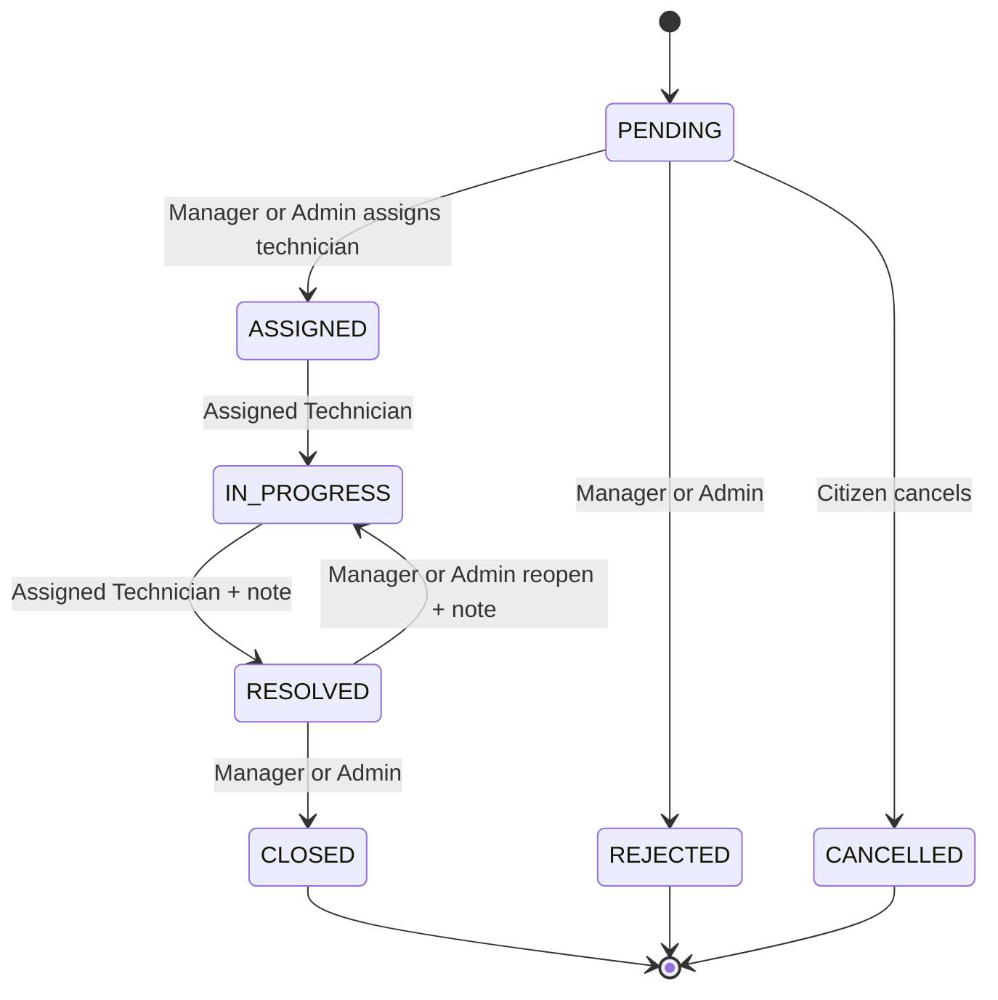

# City Complaint & Service Request Platform

Backend API for citizens to submit and track city complaints, staff to manage service work, administrators to govern users and departments, and premium subscribers to access enhanced platform limits.

## Table of Contents

- [Tech Stack](#tech-stack)
- [Features by Role](#features-by-role)
- [Architecture](#architecture)
- [Complaint Status Workflow](#complaint-status-workflow)
- [Getting Started](#getting-started)
- [API Documentation](#api-documentation)
- [Demo/Admin Credentials](#demoadmin-credentials)
- [Deployment](#deployment)
- [Roles & Approval Workflow](#roles--approval-workflow)

## Tech Stack

### Runtime

- Node.js, TypeScript, Express, cookie-parser, cors, helmet, morgan, dotenv
- bcrypt, bcryptjs, jsonwebtoken, google-auth-library

### Database

- PostgreSQL, Prisma ORM, `@prisma/client`

### Auth

- JWT access and refresh tokens, Google OAuth ID-token verification, bcrypt password hashing

### File Storage

- Cloudinary, Multer

### Payments

- Stripe

### Validation

- Zod

### Docs

- swagger-jsdoc, swagger-ui-express, openapi-to-postmanv2

### Linting

- Biome

## Features by Role

### CITIZEN

Citizens register and log in, create and manage their pending complaints, cancel eligible complaints, upload evidence, view their complaints and attachments, submit one review after resolution or closure, manage notifications, and purchase or cancel premium subscriptions. Citizens can also submit a technician or manager staff application.

### TECHNICIAN

Technicians view their assigned complaints, upload before/after-work attachments, and move assigned complaints through work and resolution transitions. They can view complaints they are assigned to and technician ratings.

### MANAGER

Managers work within their department, view and triage department complaints, assign technicians, reject complaints, close resolved complaints, reopen resolved complaints, review pending technician applications for their department, and manage complaint status transitions allowed to managers.

### ADMIN

Administrators can manage users, roles, departments, categories, audit logs, dashboard statistics, staff applications, complaint deletion, technician assignment, and manual overdue-SLA checks. Admin-only operations protect the final administrator and prevent self-role changes or self-deactivation.

## Architecture

```text
src/
├── app.ts                         # Express middleware and top-level routes
├── server.ts                      # HTTP server and scheduled-job startup
├── config/                        # Environment, Prisma, Stripe, Swagger configuration
├── jobs/                          # Background SLA scanning and scheduler
├── middlewares/                   # Authentication, validation, uploads, errors
├── modules/
│   ├── admin/                     # Administrator users, dashboard, and audit APIs
│   ├── attachments/               # Complaint file upload and management
│   ├── auth/                      # Registration, login, tokens, staff applications
│   ├── categories/                # Administrator category CRUD
│   ├── complaints/                # Complaint lifecycle and access rules
│   ├── departments/               # Public department list and admin CRUD
│   ├── notifications/             # User notification inbox and read state
│   ├── payments/                  # Stripe subscriptions and payment webhooks
│   ├── reviews/                   # Immutable complaint reviews and ratings
│   ├── staffApplications/         # Manager/admin application decisions
│   └── users/                     # Profile and password management
├── routes/                        # Central API router mounting
├── types/                         # Express request type augmentation
└── utils/                         # Response helpers and user sanitization
```

Each module owns its validation, service, controller, and route files where that layer exists. Shared configuration and middleware remain under `src/config` and `src/middlewares`.

## Complaint Status Workflow



The service also enforces ownership and department scope, and requires notes for rejection, resolution, and reopening.

## Getting Started

### Prerequisites

- Node.js 24.x and npm
- PostgreSQL
- Cloudinary account
- Stripe account and Stripe CLI

### Clone and Install

```bash
git clone https://github.com/Fahim7600/City-Complaint-Platform.git
cd City-Complaint-Platform
npm install
```

### Environment Variables

Create `.env` from `.env.example` and configure:

- `PORT`: HTTP port used by the API.
- `DATABASE_URL`: PostgreSQL connection string.
- `NODE_ENV`: runtime environment name.
- `ALLOWED_ORIGINS`: comma-separated CORS origins.
- `ADMIN_SEED_EMAIL`: seed administrator email.
- `ADMIN_SEED_PASSWORD`: seed administrator password.
- `DEMO_USERS_PASSWORD`: seed demo-user password.
- `JWT_ACCESS_SECRET`: access-token signing secret.
- `JWT_REFRESH_SECRET`: refresh-token signing secret.
- `JWT_ACCESS_EXPIRY`: access-token lifetime.
- `JWT_REFRESH_EXPIRY`: refresh-token lifetime.
- `GOOGLE_CLIENT_ID`: Google OAuth client ID.
- `CLOUDINARY_CLOUD_NAME`: Cloudinary cloud name.
- `CLOUDINARY_API_KEY`: Cloudinary API key.
- `CLOUDINARY_API_SECRET`: Cloudinary API secret.
- `STRIPE_SECRET_KEY`: Stripe server-side secret key.
- `STRIPE_WEBHOOK_SECRET`: Stripe webhook signing secret.
- `STRIPE_PREMIUM_PRICE_ID`: Stripe recurring premium price ID.
- `APP_BASE_URL`: public base URL used in Stripe redirects and Swagger.

### Database Setup

```bash
npx prisma migrate dev
npm run seed
```

### Run Locally

```bash
npm run dev
```

For local Stripe payments, run this in a second terminal:

```bash
stripe listen --forward-to localhost:3000/api/v1/payments/webhook
```

The SLA scheduler starts automatically with the server through `src/jobs/scheduler.ts`.

## API Documentation

Once the server is running, open [GET /api-docs](http://localhost:3000/api-docs) for Swagger UI. The generated Postman collection is available at `postman/City-Complaint-Platform.postman_collection.json`.

## Demo/Admin Credentials

Admin login credentials are provided separately for evaluation.

## Deployment

The project targets Render. The build command is `npm install && npx prisma generate && npx prisma migrate deploy && npm run build`, and the start command is `npm start`. Configure every variable listed in `.env.example` in the Render dashboard. See [DEPLOYMENT.md](DEPLOYMENT.md) for the manual steps.

## Roles & Approval Workflow

New accounts are citizens. Technician and manager applicants submit `requestedRole`, department, and the required application details; their `approvalStatus` starts as `PENDING`. Managers can decide technician applications in their department, while only admins can decide manager applications. Approval changes the account role; rejection leaves the account as a citizen.