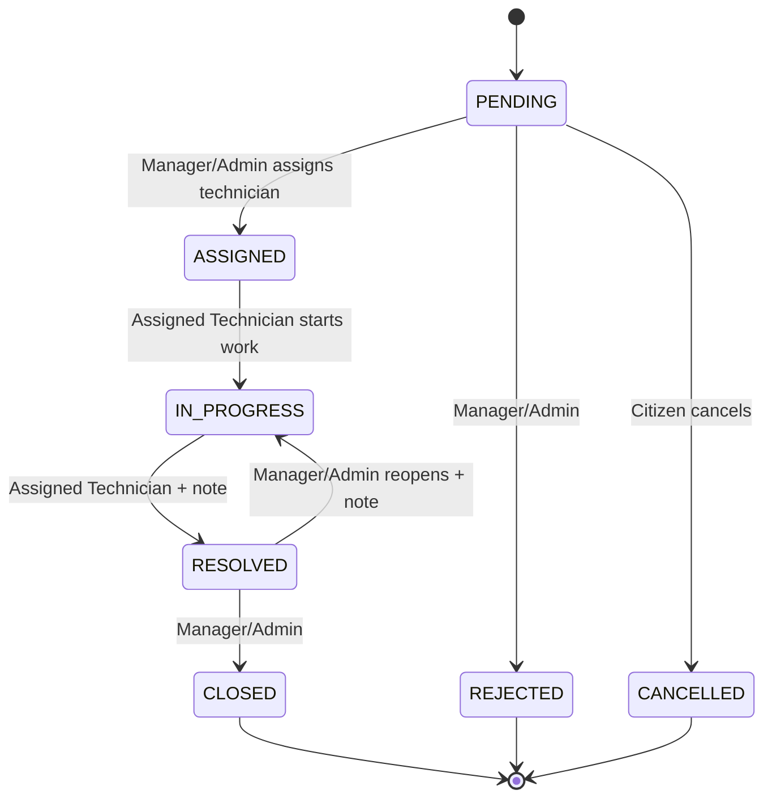

<div align="center">

# 🏙️ City Complaint & Service Request Platform

**A backend REST API for reporting, routing, and resolving city service issues — from a citizen's pothole report to a technician's closed work order.**

[](https://nodejs.org)
[](https://www.typescriptlang.org)
[](https://expressjs.com)
[](https://www.postgresql.org)
[](https://stripe.com)

[**🔗 Live API**](#) · [**📘 Swagger Docs**](#) · [**📮 Postman Collection**](#)
<sub>*(links go live after deployment — see [Deployment](#deployment))*</sub>

</div>

---

## Overview

Citizens report city issues (potholes, water outages, sanitation problems, etc.), which get automatically routed to the right department by category, assigned to a technician, tracked against an SLA deadline, and moved through a controlled status workflow to resolution and citizen feedback. Managers triage and assign work within their department; Admins oversee users, departments, and platform-wide operations. A premium subscription tier (Stripe-powered) unlocks priority handling and higher upload limits.

This is a **backend-only** project — no frontend. All endpoints are documented via Swagger/OpenAPI and a ready-to-import Postman collection, and are designed to be exercised directly.

---

## Table of Contents

- [Tech Stack](#tech-stack)
- [Features by Role](#features-by-role)
- [Architecture](#architecture)
- [Complaint Status Workflow](#complaint-status-workflow)
- [Getting Started](#getting-started)
- [API Documentation](#api-documentation)
- [Demo Credentials](#demo-credentials)
- [Deployment](#deployment)
- [Roles & Approval Workflow](#roles--approval-workflow)

---

## Tech Stack

| Category | Technologies |
|---|---|
| **Runtime & Framework** | Node.js, TypeScript, Express |
| **Database & ORM** | PostgreSQL, Prisma, `@prisma/client` |
| **Authentication** | JWT (access + refresh), Google OAuth (ID-token verification), bcrypt |
| **File Storage** | Cloudinary, Multer |
| **Payments** | Stripe (Checkout, Billing, Webhooks) |
| **Validation** | Zod |
| **Security & Middleware** | Helmet, CORS, cookie-parser, morgan |
| **API Documentation** | swagger-jsdoc, swagger-ui-express, openapi-to-postmanv2 |
| **Linting & Formatting** | Biome |

---

## Features by Role

<table>
<tr><td width="120"><strong>🧍 Citizen</strong></td><td>

Register/log in (email+password or Google), create and track complaints, cancel a pending complaint, upload evidence attachments, view technician ratings, submit one review after resolution, manage notifications, apply for a Technician/Manager role, purchase or cancel a premium subscription.

</td></tr>
<tr><td><strong>🔧 Technician</strong></td><td>

View assigned complaints, upload before/after-work attachments, move an assigned complaint through `IN_PROGRESS → RESOLVED`.

</td></tr>
<tr><td><strong>🗂️ Manager</strong></td><td>

View and triage complaints for their own department, assign technicians, reject or close complaints, reopen a resolved complaint, approve/reject Technician applications for their department.

</td></tr>
<tr><td><strong>👑 Admin</strong></td><td>

Manage users, roles, departments, categories; approve Manager applications; view dashboard statistics and audit logs; override any complaint or user record; trigger manual SLA checks. Protected against self-lockout (can't self-demote, self-deactivate, or remove the last remaining admin).

</td></tr>
</table>

---

## Architecture

```text
src/
├── app.ts                    # Express app, middleware, route mounting
├── server.ts                 # HTTP server entry point + scheduled-job startup
├── config/                   # Env validation, Prisma client, Stripe, Swagger
├── jobs/                     # SLA-overdue background scan + scheduler
├── middlewares/               # Auth, validation, file upload, error handling
├── modules/
│   ├── admin/                 # User management, dashboard stats, audit logs
│   ├── attachments/           # File uploads (Cloudinary)
│   ├── auth/                  # Register, login, tokens, staff applications
│   ├── categories/            # Category CRUD (admin)
│   ├── complaints/            # Complaint lifecycle + access control
│   ├── departments/           # Department CRUD (admin) + public listing
│   ├── notifications/         # In-app notification inbox
│   ├── payments/              # Stripe subscriptions + webhooks
│   ├── reviews/                # Immutable citizen reviews + technician ratings
│   ├── staffApplications/     # Approval workflow for Technician/Manager
│   └── users/                  # Profile + password management
├── routes/                    # Central router
├── types/                     # Express request type augmentation
└── utils/                     # Response helpers, sanitization
```

Every feature module follows the same internal shape: **`*.validation.ts` → `*.service.ts` → `*.controller.ts` → `*.routes.ts`**.

---

## Complaint Status Workflow



> Every transition enforces role, ownership, and department scope, and requires a note for rejection, resolution, and reopening.

---

## Getting Started

### Prerequisites

- Node.js 24.x + npm
- PostgreSQL
- A [Cloudinary](https://cloudinary.com) account
- A [Stripe](https://stripe.com) account + the [Stripe CLI](https://docs.stripe.com/stripe-cli)

### Installation

```bash
git clone https://github.com/Fahim7600/City-Complaint-Platform.git
cd City-Complaint-Platform
npm install
```

### Environment Variables

Copy `.env.example` to `.env` and fill in:

| Variable | Description |
|---|---|
| `PORT` | HTTP port the API listens on |
| `DATABASE_URL` | PostgreSQL connection string |
| `NODE_ENV` | Runtime environment name |
| `ALLOWED_ORIGINS` | Comma-separated CORS origins |
| `ADMIN_SEED_EMAIL` / `ADMIN_SEED_PASSWORD` | Seed administrator login |
| `DEMO_USERS_PASSWORD` | Seed demo-user password |
| `JWT_ACCESS_SECRET` / `JWT_REFRESH_SECRET` | Token signing secrets |
| `JWT_ACCESS_EXPIRY` / `JWT_REFRESH_EXPIRY` | Token lifetimes |
| `GOOGLE_CLIENT_ID` | Google OAuth client ID |
| `CLOUDINARY_CLOUD_NAME` / `CLOUDINARY_API_KEY` / `CLOUDINARY_API_SECRET` | Cloudinary credentials |
| `STRIPE_SECRET_KEY` | Stripe secret key |
| `STRIPE_WEBHOOK_SECRET` | Stripe webhook signing secret |
| `STRIPE_PREMIUM_PRICE_ID` | Stripe recurring price ID for premium |
| `APP_BASE_URL` | Public base URL (used in Stripe redirects, Swagger) |

### Database Setup

```bash
npx prisma migrate dev
npm run seed
```

### Run Locally

```bash
npm run dev
```

For local payment testing, in a **second terminal**:

```bash
stripe listen --forward-to localhost:3000/api/v1/payments/webhook
```

> The SLA-overdue scheduler starts automatically alongside the server (`src/jobs/scheduler.ts`).

---

## API Documentation

| Format | Link |
|---|---|
| **Swagger / OpenAPI (live)** | [`/api-docs`](#) *← add hosted URL after deploy* |
| **Postman Collection** | [`postman/City-Complaint-Platform.postman_collection.json`](./postman/City-Complaint-Platform.postman_collection.json) |
| **Local Swagger** | `http://localhost:3000/api-docs` once running |

---

## Demo Credentials

> Admin and role-based demo credentials are provided separately for evaluation.

| Role | Email | Password |
|---|---|---|
| Admin | *provided separately* | *provided separately* |

---

## Deployment

**Target:** [Render](https://render.com)

| | |
|---|---|
| **Build command** | `npm install && npx prisma generate && npx prisma migrate deploy && npm run build` |
| **Start command** | `npm start` |
| **Health check** | `GET /api/v1/health` |

Configure every variable from `.env.example` in Render's dashboard. Full manual steps in [`DEPLOYMENT.md`](./DEPLOYMENT.md).

**Live URL:** `#` *← add after deploy*

---

## Roles & Approval Workflow

Every new account starts as a **Citizen**. To become a **Technician** or **Manager**, an applicant submits `requestedRole`, a department, and (for Manager) experience/qualifications — their account sits `PENDING` until reviewed:

- **Technician applications** → approved/rejected by a **Manager of that same department**, or an Admin.
- **Manager applications** → approved/rejected by an **Admin only**.

Approval promotes the account to the requested role; rejection leaves it as a Citizen. `role` never changes anywhere else in the system except through this flow (or an Admin's capped override, which itself can never grant `ADMIN`).

---

<div align="center">
<sub>Built as a backend-focused systems project — no frontend, fully testable via Swagger/Postman.</sub>
</div>
